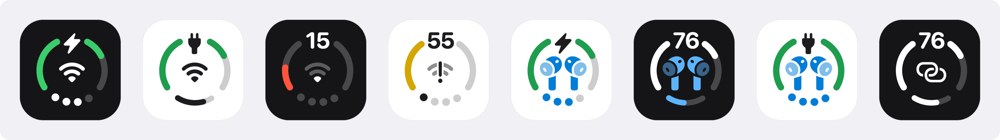
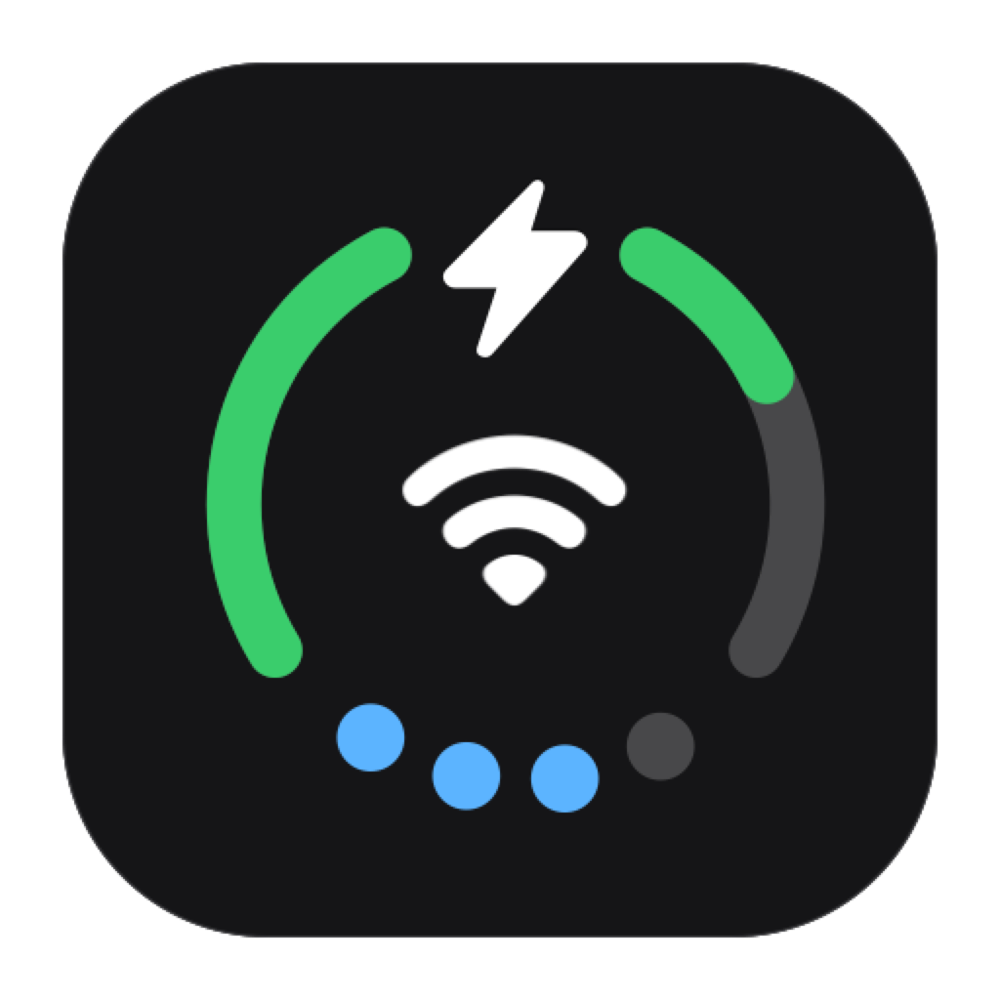
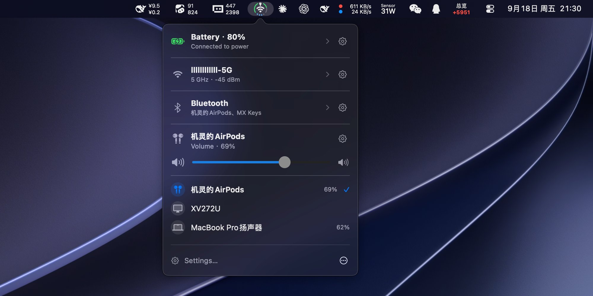
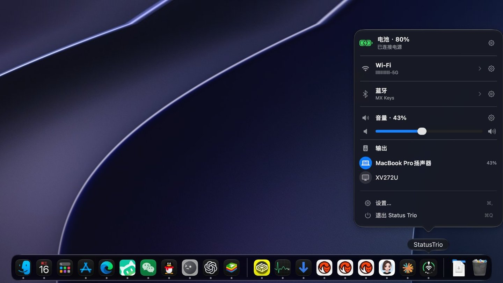
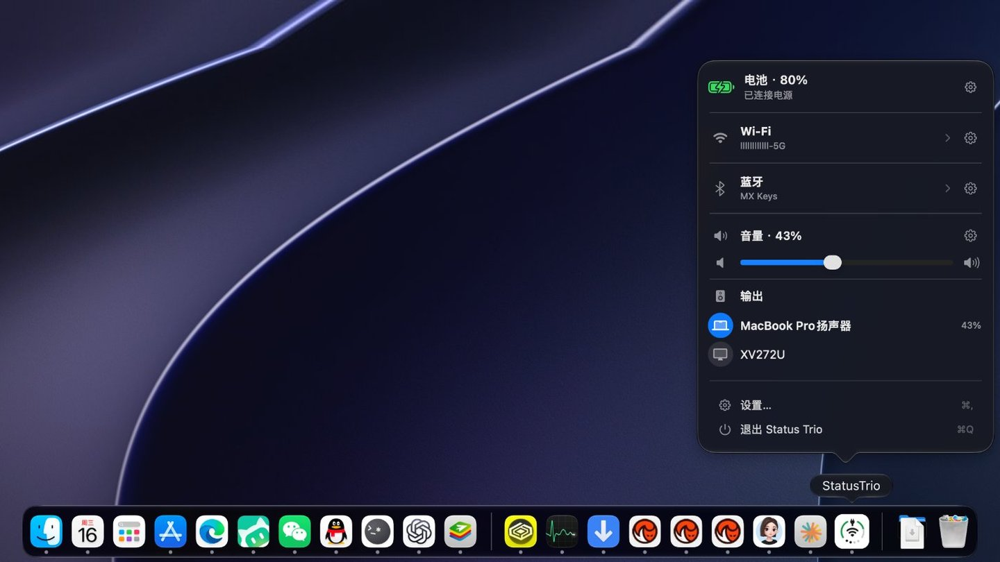
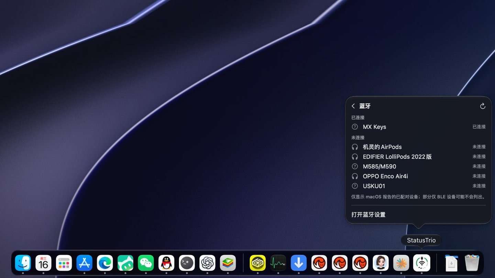
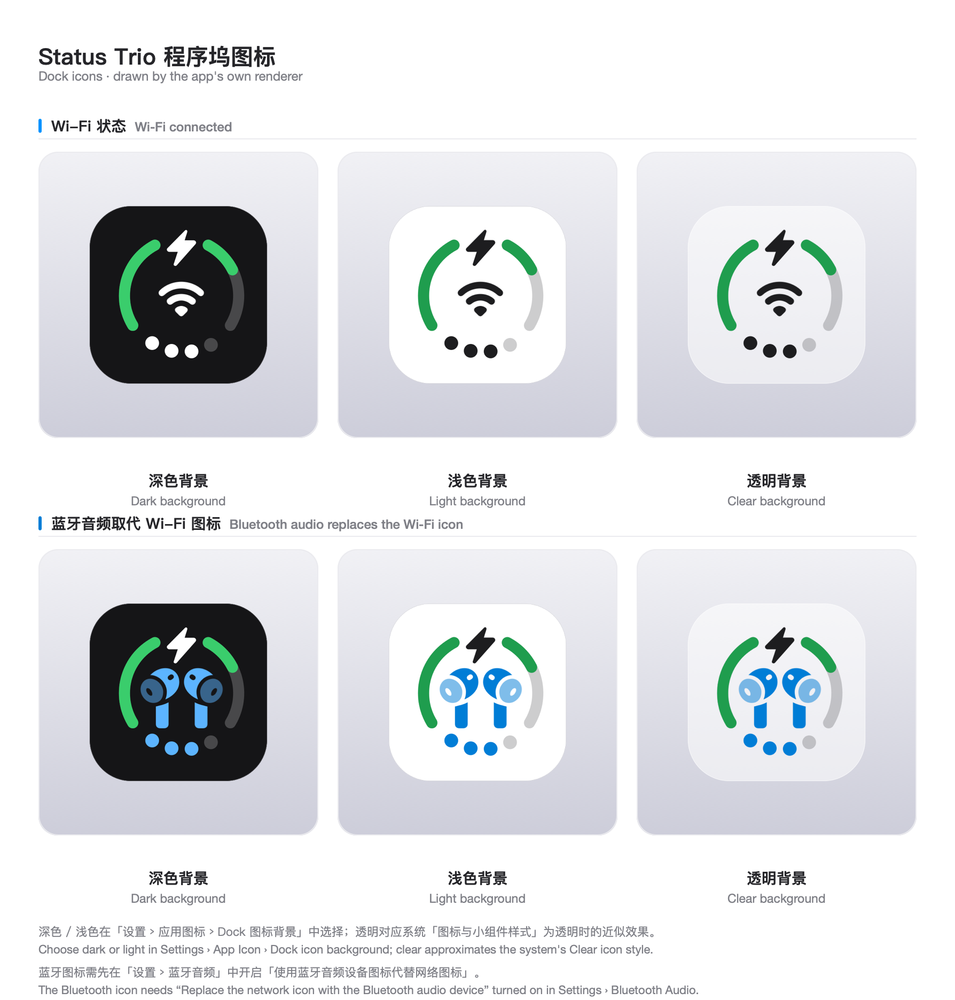
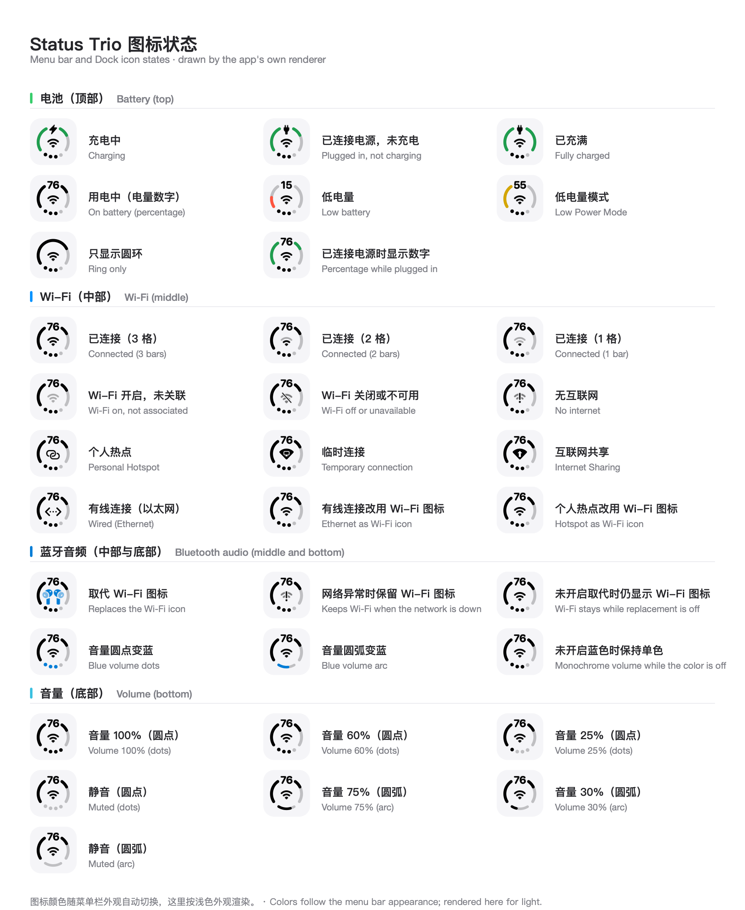
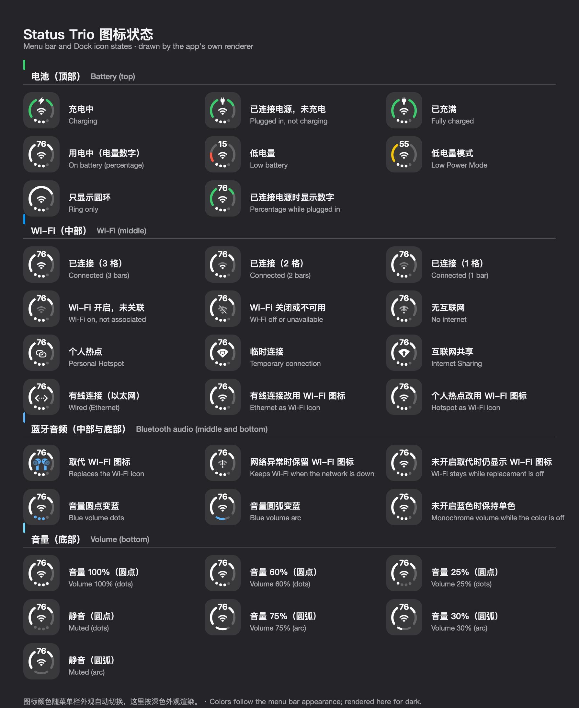

<p align="center">
  
</p>

<p align="center">
  
</p>

<h1 align="center">Status Trio</h1>

<p align="center">
  <a href="https://trendshift.io/repositories/234371?utm_source=trendshift-badge&utm_medium=badge&utm_campaign=badge-trendshift-234371" target="_blank" rel="noopener noreferrer"></a>
</p>

<p align="center"><strong>Three system signals. One native macOS status icon — in your menu bar or the Dock.</strong></p>

<p align="center">
  <a href="https://github.com/lingyired/status-trio/releases/latest"></a>
</p>

<p align="center">
  Want to see it in action first? Open <a href="https://statustrio.lingai.net/">statustrio.lingai.net</a> to simulate every icon state in your browser.
</p>

<p align="center">
  <a href="https://github.com/lingyired/status-trio/releases/latest"></a>
  <a href="https://github.com/lingyired/status-trio/actions/workflows/release.yml"></a>
  <a href="LICENSE"></a>
</p>

<p align="center">
  
  
</p>

<p align="center">
  <strong>English</strong> ·
  <a href="README.zh-Hans.md">简体中文</a> ·
  <a href="README.zh-Hant.md">繁體中文</a> ·
  <a href="README.ja.md">日本語</a> ·
  <a href="README.ko.md">한국어</a> ·
  <a href="README.es.md">Español</a> ·
  <a href="README.fr.md">Français</a> ·
  <a href="README.de.md">Deutsch</a> ·
  <a href="README.pt-BR.md">Português (Brasil)</a> ·
  <a href="README.ru.md">Русский</a>
</p>

<p align="center">
  
</p>

Status Trio is a native macOS status app that combines Wi-Fi, battery, and volume into one compact, configurable icon, shown in the menu bar, in the Dock, or in both. Its popover goes deeper than the icon: a Wi-Fi panel for nearby networks and link details, a Bluetooth panel for paired devices, a Battery Details page, and the audio devices that are playing. It is inspired by the iPhone Duo's combined status bar icon for Wi-Fi, Battery, and Cellular Data, adapted for Mac with Volume instead of Cellular Data.

> Status Trio is an independent project and is not affiliated with Apple.

## Highlights

- **One icon, three signals** — battery, Wi-Fi, and volume share one icon in the menu bar, the Dock, or both, and a Bluetooth device that is playing can take the middle spot with its own symbol.
- **Bluetooth** — the volume indicator turns blue while it plays. The panel lists paired devices you can tap to connect or disconnect, shows battery levels by default, and stays off until you enable it.
- **Battery** — percentage, charging or plugged in, time to full, and a color when it runs low. Open the row for adapter power, voltage, current, cycle count, and Low Power Mode.
- **Wi-Fi** — the network you are on and how strong the signal is. Open it to see nearby networks, check the link details, or switch Wi-Fi off. Switching between networks happens in the Wi-Fi pane of System Settings.
- **Volume** — level, mute, and the output device, drawn as dots or an arc. Scroll the whole panel or just the control, and pick which direction turns it up.
- **Make it yours** — icon size, symbol scale, ring thickness, status colors, and which sections the popover shows, in the order you want.
- **Menu bar, Dock, or both** — and the Dock icon can follow the system style or stay dark or light.
- **Native on macOS** — left-click opens the popover, right-click opens the menu, and a first-launch guide explains each part of the icon. Ethernet, a hotspot, or Internet Sharing can keep the Wi-Fi glyph if you prefer.
- **Stays current** — status comes from system events with a slow poll as a fallback, and Sparkle updates the app through a signed feed.
- **Also included** — twelve languages, and an optional launch at login.

## Install

Install from the official Homebrew Cask:

```bash
brew install --cask status-trio
```

To update an existing Homebrew installation:

```bash
brew upgrade --cask status-trio
```

Or download the latest `StatusTrio-*.dmg` from [GitHub Releases](https://github.com/lingyired/status-trio/releases/latest), open it, and drag `Status Trio.app` into `/Applications`.

The official release is signed with Developer ID and notarized by Apple. Open it normally after installation; no quarantine-removal command is needed. In-app updates use Sparkle with EdDSA signature verification.

## Input, audio, and everyday controls

- **Input-source icon** — show the current input method in the middle of the menu bar and Dock icon instead of the network glyph. Choose it in **Settings › Network**; choose an enabled input source from the panel to switch to it.
- **Global shortcut** — assign a shortcut in **Settings › General** to open or close the status panel from another app. No shortcut is assigned by default.
- **Bluetooth controls** — turn Bluetooth on or off from the panel, connect or disconnect paired devices, and switch listening modes on supported AirPods and HUAWEI FreeBuds. Optional Apple-device battery rows are configured in **Settings › Bluetooth**; availability depends on the device and connection.
- **Audio input and output** — select speakers or microphones, adjust output and input levels, and control compatible external-display speakers through DDC. Display volume support depends on the hardware and connection.
- **Charging and appearance** — enable charging effects for the menu bar and Dock. On macOS 26 and later, the app icon in Finder and Launchpad also follows the system light or dark appearance.

## New on main (not yet released)

The following features are in the source on `main`, but are not included in the current GitHub / Homebrew release, **1.7.5**:

- **Battery power flow and CPU energy impact** — the battery panel can show estimated charger input, power flowing into the battery, and system power. An optional list ranks up to five apps by CPU energy, falling back to CPU activity when energy counters are unavailable. This is not total app energy consumption or a copy of the macOS high-energy list. Enabling the list starts periodic background sampling; turning it off stops sampling. See [power flow and CPU energy impact](docs/battery-power-flow.md).
- **Charge to Full Now, with cancellation** — a button for supported Apple silicon Macs on macOS 26.4 or later temporarily overrides the native charge limit. It uses a private PowerUI interface and is enabled by default only when the capability is available; you can turn it off in Battery settings. **The charge limit may remain at 100% after charging or unplugging; it is not automatically restored.** Use **Cancel Charge to Full** to request restoration, or check and restore the limit in System Settings. Availability and behavior depend on macOS. See [behavior and verification](docs/charge-to-full-now-poc.md).

## Bluetooth audio

While audio plays over Bluetooth, two switches under **Settings › Bluetooth** let the middle glyph become that device's own symbol — AirPods, headphones, speakers, and other devices supply their own — and let the volume dots or arc turn blue. Both are off by default. **Let network errors take priority**, on by default, keeps the network icon while the connection itself is in trouble:

<p align="center">
  
</p>

The popover's Bluetooth row reports live state: the names of connected devices and, for AirPods, left, right, and case battery. The Bluetooth panel lists paired devices and their connection state: tap a device to connect it, tap a connected one to disconnect — keyboards, mice, trackpads and gamepads ask for confirmation in the row first. The panel is off by default, is enabled under **Settings › Status Panel**, and asks for Bluetooth permission on first use. **Settings › Bluetooth** also controls whether the battery levels are read — on by default — lists the paired devices so you can drag them into the order the panel shows and set how many appear, and scales the Bluetooth icon from 100% to 180%.

## Dock icon

The same live icon can live in the Dock instead of the menu bar, or in both places at once:

<p align="center">
  
  <br>
  <sub>Dock icon in dark appearance</sub>
</p>

<p align="center">
  
  <br>
  <sub>Dock icon in light appearance</sub>
</p>

<p align="center">
  
  <br>
  <sub>Bluetooth panel preview</sub>
</p>

The Dock icon draws the same combined icon as the menu bar, so with Bluetooth audio replacement enabled the device glyph takes over the middle there too. Its background can follow the system icon style or be pinned to a fixed shade:

<p align="center">
  
</p>

## Icon states

Every state the combined icon can show, drawn by the app's own renderer — battery indicators on top, Wi-Fi (or the Bluetooth audio device that can replace it, when that option is on) in the middle, and volume dots or the arc at the bottom, turning blue while a Bluetooth device is playing:

<p align="center">
  
</p>

The same states rendered for a dark menu bar:

<p align="center">
  
</p>

## Requirements

- macOS 13 deployment target; Ventura runtime validation pending
- Swift 6 toolchain with the macOS 26 SDK or newer to build it; the formal
  release workflow uses the `xcode-27` runner and Xcode 27. Building against an
  older SDK silently produces the pre-Tahoe popover appearance, so
  `scripts/build-app.sh` fails when the SDK is older than 26.

## Run from source

```bash
git clone https://github.com/lingyired/status-trio.git
cd status-trio
swift run StatusTrio
```

## Build a local app

Build an ad-hoc-signed app bundle and launch it:

```bash
bash scripts/build-app.sh release
```

The bundle is created at `dist/StatusTrio.app`. To build without quitting or launching an existing instance, run:

```bash
bash scripts/build-app.sh release no-open
```

The ad-hoc-signed bundle is intended for local personal use. Gatekeeper may reject it if the bundle is transferred with quarantine metadata.

## Usage

- **Left-click** the menu bar icon or the Dock icon to open the status popover.
- **Right-click** either icon for the native menu, including version and quit actions.
- Select the Wi-Fi or battery row in the popover to open its page: nearby networks and link details, or Battery Details. The Bluetooth row lists its paired devices in place — tap one to connect or disconnect — with an Expand control when they do not all fit.
- Open **Settings** to choose where the icon is shown (menu bar, Dock, or both) and to change its size, colors, ring thickness, the panel sections and their order, scroll-to-adjust behavior, language, update checks, and launch at login.
- Reopen the **Meet your icon** guide any time from **Settings › App Icon › Open Guide**.
- Enable the current Wi-Fi network name when prompted; macOS requests location access for this optional detail.

## Known limitations

Two boundaries macOS and this project draw deliberately. Both are explained in [Known limitations](docs/known-limitations.md).

- **Switching networks happens in System Settings.** Choosing a network in the popover opens the Wi-Fi pane; Status Trio never reads or stores Wi-Fi passwords, because macOS offers no public API to connect with a saved password and every alternative ends with the app holding them.
- **Charge-limit controls depend on the version.** Release 1.7.5 opens System Settings for charging overrides. The opt-in action on `main` uses a private interface and requires explicit cancellation to request restoration; see [New on main](#new-on-main-not-yet-released). Low Power Mode uses a separate [opt-in privileged helper](docs/privileged-helper.md).

## Languages

Status Trio follows the macOS preferred language by default and includes English, Simplified Chinese, Traditional Chinese, Japanese, Korean, Spanish, French, German, Italian, Brazilian Portuguese, Russian, and Arabic.

## Privacy

Status Trio reads system status locally. Optional anonymous usage statistics are sent to the first-party service only after you enable them; upgrades start with statistics off, and new installs ask during onboarding. The heartbeat contains a random installation ID, app and macOS versions, language, and icon placement, with no names, account details, network details, or hardware identifiers. See [telemetry and privacy](docs/privacy-telemetry.md). Status Trio does not read or store Wi-Fi passwords or request Keychain access. Location access is optional for the current Wi-Fi network name and details; Bluetooth access is requested when you enable the Bluetooth panel. On `main`, the optional charge-to-full control uses a private PowerUI interface only when enabled; see its behavior and limits above.

## Development

Run the risk-sized local verification (no GitHub Actions, signing, or release):

```bash
bash scripts/verify-local.sh quick BatteryMonitorTests
bash scripts/verify-local.sh docs
bash scripts/verify-local.sh full
```

Use `quick` for an isolated code change, `docs` for documentation or
localization-only work, and `full` for state, concurrency, rendering, Helper,
or build-pipeline changes. `full` builds a non-Universal development app bundle;
it does not produce the release package.

When you need only a focused Swift test, keep using the existing test helper:

```bash
bash scripts/test.sh BatteryMonitorTests
```

Formal release verification is separate from daily development. A merged change
is not a built artifact, and a built artifact is not a released version.

To build a worktree app alongside the main installation:

```bash
bash scripts/build-worktree.sh release
```

The helper derives a development bundle identifier and display name from the current branch. Both values can be overridden:

```bash
BUNDLE_ID=com.lingsmbp.StatusTrio.dev.settings-redesign \
APP_NAME="Status Trio (Settings Redesign)" \
bash scripts/build-worktree.sh release
```

The single-instance lock is scoped by bundle identifier, so differently identified builds can run at the same time.

### Icon presentation API

For the three icon regions, update timing, Swift examples, and extension boundaries, see [三图形展示与更新 API](docs/api/icon-presentation.md). This documents the current internal API; an external plugin SDK is not implemented.

## Technical baseline

- Swift 6
- SwiftUI + AppKit
- macOS 13 deployment target (Ventura runtime validation pending)
- `LSUIElement` menu bar accessory that switches to a regular activation policy while the Dock icon is shown
- Sparkle for update checks

## Documentation

- [Known limitations](docs/known-limitations.md)
- [Battery power flow and CPU energy impact](docs/battery-power-flow.md)
- [Charge to Full Now: behavior and verification](docs/charge-to-full-now-poc.md)
- [Status panel global shortcut](docs/status-panel-global-shortcut.md)
- [Automated GitHub Actions releases](docs/github-actions-release.md)
- [Status Trio design specification](docs/superpowers/specs/2026-09-12-status-trio-design.md)
- [Menu bar icon SVG](status-menubar.svg)
- [Data-driven icon demo](status-menubar-demo.html)

## License

Copyright 2026 lingyired.

Licensed under the Apache License, Version 2.0. See [LICENSE](LICENSE) and [NOTICE](NOTICE).

## Author

Created and maintained by [lingyired](https://github.com/lingyired).<br>
Website: [https://statustrio.lingai.net/](https://statustrio.lingai.net/)

## Star History

<a href="https://www.star-history.com/?repos=lingyired%2Fstatus-trio&type=date&legend=top-left">
 <picture>
   <source media="(prefers-color-scheme: dark)" srcset="https://api.star-history.com/chart?repos=lingyired/status-trio&type=date&theme=dark&legend=top-left" />
   <source media="(prefers-color-scheme: light)" srcset="https://api.star-history.com/chart?repos=lingyired/status-trio&type=date&legend=top-left" />
   
 </picture>
</a>
